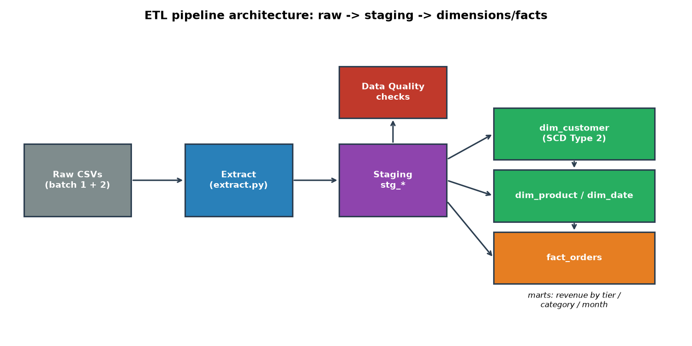
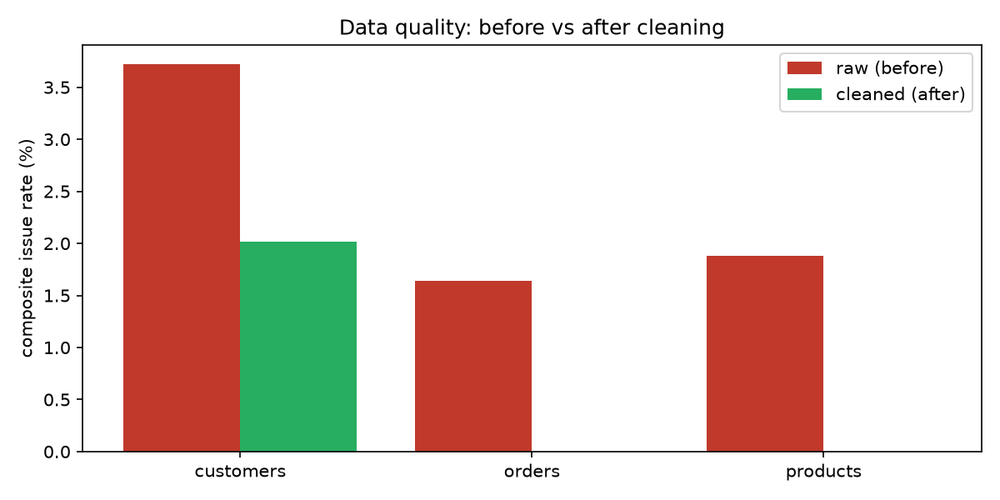
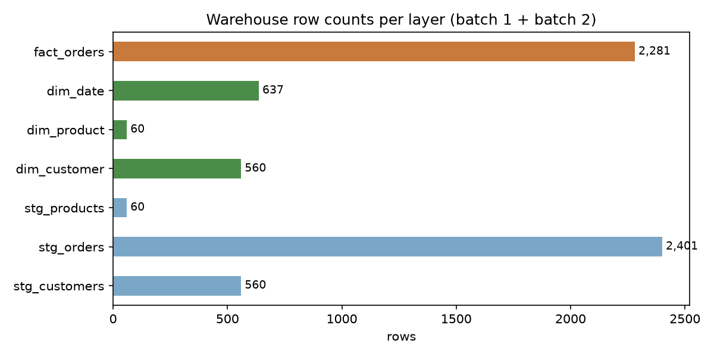

# End-to-End ETL Data Warehouse Pipeline

> **Portfolio project — all data is synthetic.** Generated by `src/generate_data.py`
> (`random_state=42`). No real companies, customers, or transactions are involved.

A production-style ETL pipeline that ingests messy raw retail CSVs, profiles and
cleans them, and loads them into an analytics-ready data warehouse (SQLite) with
proper dimensional modeling — including **SCD Type 2** slowly-changing dimensions,
data-quality checks at every stage, and **dbt-style** staging/mart naming
(`stg_*` → `dim_*` / `fact_*`).

## Business Problem

Raw operational data is never clean: source systems emit nulls, duplicates,
inconsistent casing, mixed date formats, invalid emails, and broken foreign
keys. Business teams still need trustworthy KPIs — revenue, margin, average
order value by customer tier, category performance, monthly trends. This project
builds the full path from messy source files to a governed warehouse that can
answer those questions in SQL, with every cleaning decision explicit, counted,
and validated.

## Dataset

Synthetic retail data (seeded, reproducible) in `data/raw/`:

| File | Rows | Intentional mess |
|---|---|---|
| `customers_raw.csv` | 540 | 7.4% exact duplicates, 14.6% invalid emails, null phones/cities, mixed casing, 3 date formats |
| `orders_raw.csv` | 2,080 | 3.9% duplicates, null/negative quantities, orphan customer & product keys, discount > 100% |
| `products_raw.csv` | 63 | 4.8% duplicates, null costs, cost > list price (invalid margin) |
| `batch2/customers_batch2.csv` | 62 | incremental load: 30 customers change city/tier (SCD Type 2 demo) + 30 new customers |
| `batch2/orders_batch2.csv` | 520 | 500 new orders for the incremental fact load |

See [`data/README.md`](data/README.md) for details.

## Objectives

1. Extract two raw batches with row-count validation.
2. Profile data quality **before** cleaning (null rates, duplicate rates, domain-rule violations).
3. Clean and conform with explicit, counted rules — no silent drops.
4. Load a dimensional warehouse: `dim_customer` (SCD Type 2), `dim_product`,
   `dim_date`, `fact_orders`.
5. Prove the improvement: data-quality **before vs after** from the real run.
6. Answer business questions from the marts with SQL.

## Architecture

```
data/raw/*.csv ──▶ extract.py ──▶ data_quality.py (BEFORE report)
       │ batch 1 (full) / batch 2 (incremental)
       ▼
transform.py ──▶ stg_customers / stg_orders / stg_products   (staging, 1:1 with source)
       │
       ├─▶ dim_customer   (SCD Type 2: surrogate key, effective_date/end_date/is_current)
       ├─▶ dim_product    (Type 1)
       ├─▶ dim_date       (date dimension, YYYYMMDD surrogate key)
       └─▶ fact_orders    (grain = one order line; line_total / line_cost / line_margin)
```

Layer naming follows dbt conventions (`stg_*` staging models, `dim_*`/`fct_*`
marts). SQLite is used so the warehouse runs anywhere; [`sql/ddl.sql`](sql/ddl.sql)
includes commented **Snowflake and Redshift equivalents** for the key objects
(autoincrement/identity surrogate keys, clustering/distribution keys).



## Data Cleaning

All rules live in `src/transform.py`; each reports how many rows it touched:

- **Customers** — drop exact duplicates; dedupe natural key `customer_id` keeping
  the most complete record; strip whitespace; title-case names/cities; emails
  lowercased and regex-validated (invalid → NULL, counted, not dropped);
  `signup_date` parsed across `MM/DD/YYYY`, `YYYY-MM-DD`, `DD-MM-YYYY`;
  loyalty tier canonicalised to Gold/Silver/Bronze/Platinum (null → `Unknown`).
- **Products** — dedupe `product_id`; null `cost` imputed with the category
  median (counted); `cost > list_price` capped at list price so margin = 0 (counted).
- **Orders** — dedupe `order_id`; unparseable dates, null/non-positive quantities
  and prices dropped (counted); null `discount_pct` → 0, >100 capped at 100
  (counted); status canonicalised; **orphan customer/product keys excluded from
  the fact** (counted, retained in staging for audit).

## Data Quality — before vs after (from the real run)

| Check | Before | After |
|---|---|---|
| Customer duplicates | 7.41% | 0% |
| Order duplicates | 3.85% | 0% |
| Product duplicates | 4.76% | 0% |
| Invalid emails | 14.63% | 0% (nulled & flagged) |
| Bad quantities (null / ≤ 0) | 3.03% | 0% |
| Orphan customer keys in orders | 3.03% | 0% |
| Orphan product keys in orders | 2.02% | 0% |
| Invalid product margins (cost > price) | 9.52% | 0% |
| Null product costs | 6.35% | 0% (imputed) |



One honest exception: the null-*email* rate rises (7.78% → 11.6%) because
invalid emails are nulled rather than deleting the customer row — flagged in
the report instead of hidden.

## SQL Analysis

Sample mart queries (see `notebooks/analysis.ipynb` for the full run):

```sql
-- Revenue, margin and AOV by loyalty tier
SELECT c.loyalty_tier,
       COUNT(DISTINCT f.order_id)   AS orders,
       ROUND(SUM(f.line_total), 2)  AS revenue,
       ROUND(SUM(f.line_margin), 2) AS margin,
       ROUND(AVG(f.line_total), 2)  AS avg_order_value
FROM fact_orders f
JOIN dim_customer c ON f.customer_sk = c.customer_sk
GROUP BY 1 ORDER BY revenue DESC;

-- Point-in-time SCD2 query: a customer's tier history
SELECT customer_id, loyalty_tier, city, effective_date, end_date, is_current
FROM dim_customer
WHERE customer_id = 'CUST-0026'
ORDER BY effective_date;

-- Monthly revenue trend
SELECT d.year, d.month_name, ROUND(SUM(f.line_total), 2) AS revenue
FROM fact_orders f
JOIN dim_date d ON f.date_sk = d.date_sk
GROUP BY 1, 2 ORDER BY 1, 2;
```

## EDA

The notebook's walkthrough covers: raw-file profiling, the cleaning report with
per-rule counts, SCD Type 2 history inspection, revenue/margin/AOV by tier,
category/subcategory performance, and the monthly revenue trend (total synthetic
revenue **$1,214,052.31**, margin **$931,437.48** across 2,281 fact rows).

## Key Insights

- Cleaning removed 7.4% duplicate customers and 3.9% duplicate orders, fixed
  14.6% invalid emails, and excluded **120 orphan order rows** — the fact table
  is fully referentially clean (0 null surrogate keys).
- SCD Type 2 preserved history for **30 customers** whose tier/city changed
  between batches: 530 current rows serve BI, 30 history rows serve
  point-in-time analysis.
- The marts answer KPI questions directly in SQL with no further wrangling.

## Dashboard

No BI tool is required to review this project — the warehouse is the product.
[`dashboard/README.md`](dashboard/README.md) lists the KPI definitions the marts
now support (revenue, margin, AOV by tier/category/month; customer-tier
migration via SCD2) and how to point Power BI / Tableau at `warehouse.db`.



## Results & Metrics

Final warehouse row counts (batch 1 full load + batch 2 incremental):

| Layer | Table | Rows |
|---|---|---|
| Staging | `stg_customers` | 560 |
| Staging | `stg_orders` | 2,401 |
| Staging | `stg_products` | 60 |
| Dimension | `dim_customer` (SCD2) | 560 (530 current + 30 history) |
| Dimension | `dim_product` | 60 |
| Dimension | `dim_date` | 637 |
| Fact | `fact_orders` | 2,281 |

Quality improvement: every duplicate/domain-violation rate driven to 0%;
120 orphan rows quarantined from the fact; 30 SCD Type 2 versions created.

## Technologies Used

Python, pandas, NumPy, SQLite, matplotlib, Jupyter — dimensional modeling
(star schema, surrogate keys, SCD Type 2), data-quality validation,
dbt-style layer naming, with Snowflake/Redshift DDL equivalents documented.

## How to Run

```bash
# 1. Install dependencies
pip install -r requirements.txt

# 2. Generate the synthetic messy raw data (seeded, reproducible)
python src/generate_data.py

# 3. Run the full pipeline: extract -> validate -> transform -> load
python src/run_pipeline.py        # builds warehouse.db from scratch

# 4. Reproduce the documented run (notebook already committed WITH outputs)
jupyter nbconvert --to notebook --execute notebooks/analysis.ipynb \
  --output analysis.ipynb --allow-errors
```

Inspect the warehouse directly:

```bash
sqlite3 warehouse.db "SELECT COUNT(*) FROM fact_orders;"
```

## Resume-Ready Description

> Built an end-to-end ETL pipeline in Python loading messy synthetic retail
> data into a SQLite warehouse with SCD Type 2 dimensions, data-quality
> checks, and dbt-style staging/mart layers.
